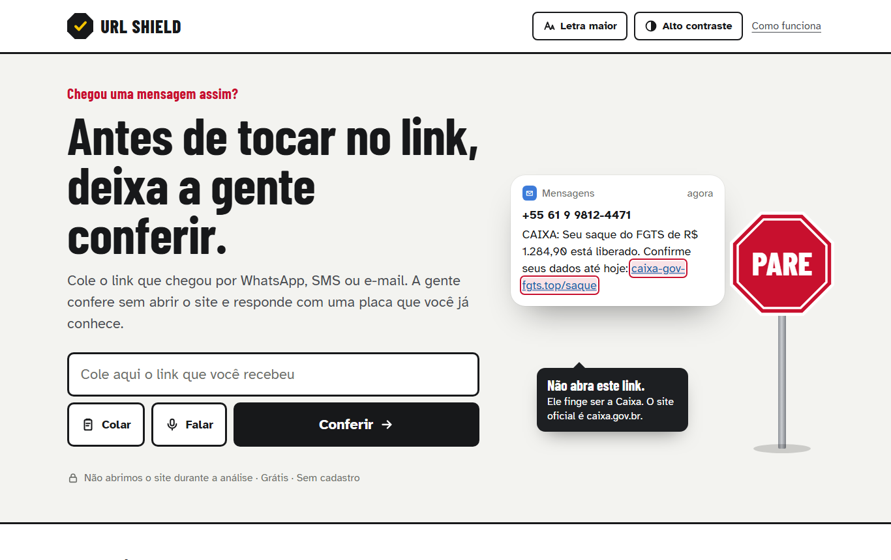
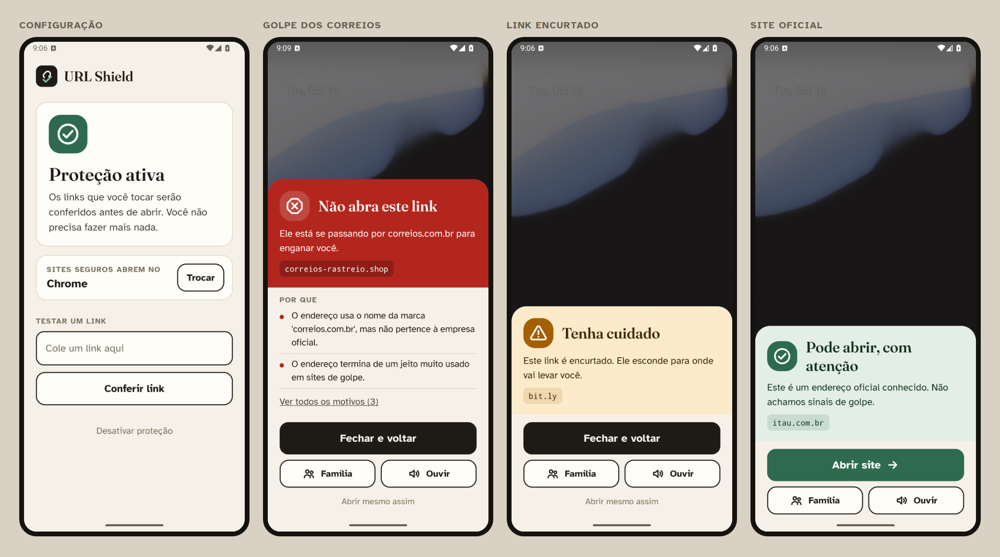
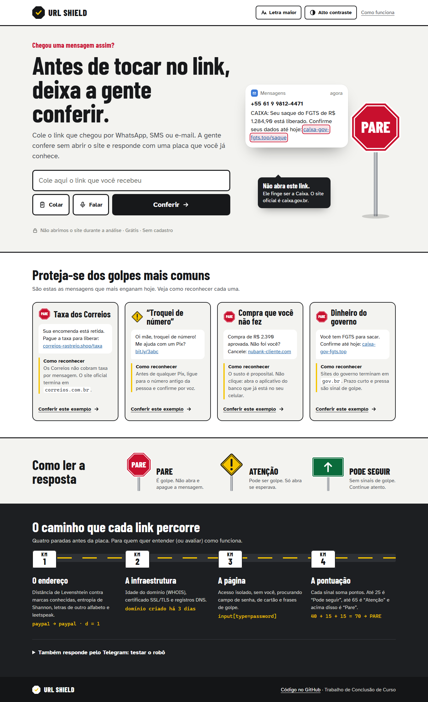
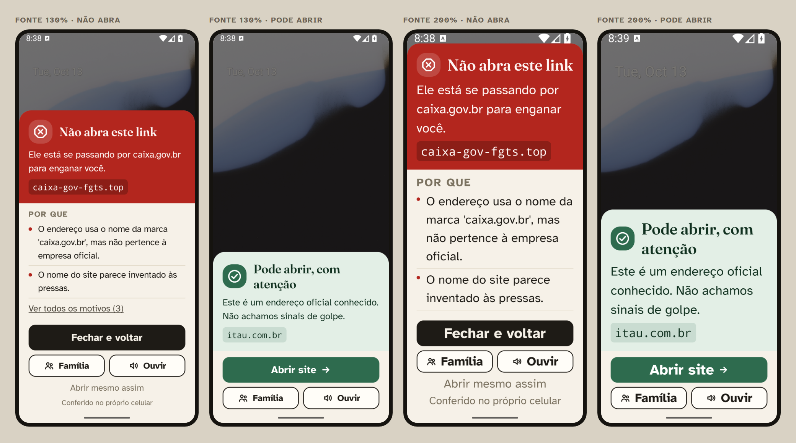

<p align="center">
  
</p>

# URL Shield

**Antes de tocar no link, deixa a gente conferir.**

Todo mundo conhece alguém que quase caiu. A mensagem chega no WhatsApp ou por SMS, fala de um saque do FGTS, de uma encomenda retida nos Correios, de uma compra que você não fez. O link parece de verdade. E quem mais sofre com isso são justamente as pessoas que têm menos familiaridade com a internet: nossos pais, avós, vizinhos.

O URL Shield confere o link **antes** de a pessoa abrir o site e responde de um jeito que qualquer um entende: com uma placa de trânsito. **PARE** quando é golpe, **ATENÇÃO** quando é suspeito, e a placa verde de **PODE SEGUIR** mostrando para onde o link leva de verdade.

> Projeto desenvolvido como Trabalho de Conclusão de Curso.

**Experimente agora:** [urlshield-api-x9et.onrender.com](https://urlshield-api-x9et.onrender.com)
<sub>(está no plano gratuito do Render; se ninguém acessou nos últimos minutos, a primeira consulta pode levar até um minuto para “acordar” o servidor)</sub>

---

## No celular, a proteção acontece sozinha

No Android, o URL Shield vira o “porteiro” dos links. A pessoa toca no link normalmente, dentro do WhatsApp, e em vez de o site abrir aparece um cartão por cima da conversa com a resposta. Se estiver tudo certo, um toque em **Abrir site** leva para o Chrome de sempre. Se for golpe, **Fechar e voltar** e pronto.

<p align="center">
  
</p>

O cartão diz **quem o link está imitando** (“Ele está se passando por correios.com.br”), explica os motivos em linguagem simples e tem dois botões pensados para quem precisa de ajuda: **Ouvir**, que lê a resposta em voz alta, e **Família**, que manda o link com a resposta para um parente conferir.

Funciona até sem internet: um motor de análise roda dentro do próprio celular e, quando há conexão, o servidor completa a checagem com a idade do site e o certificado de segurança.

---

## Como o link é analisado

Cada link passa por quatro paradas antes de ganhar a placa:

1. **O endereço.** É aqui que entra a matemática. A *distância de Levenshtein* mede o quanto um nome se parece com o de uma marca conhecida (`paypa1` está a um caractere de `paypal`). A *entropia de Shannon* mede o quanto o nome parece inventado às pressas. Também procuramos letras de outros alfabetos disfarçadas de letras comuns, trocas como `0` por `o`, links encurtados e terminações baratas que golpistas adoram (`.shop`, `.top`, `.xyz`).
2. **A infraestrutura.** Idade do domínio (WHOIS), certificado de segurança (SSL/TLS) e registros de DNS.
3. **A página.** Um acesso isolado, sem envolver a pessoa, procura campos de senha e de cartão e frases típicas de golpe. Esse acesso só vai para endereços públicos da internet, nunca para a rede interna do servidor.
4. **A pontuação.** Cada sinal soma pontos. Até 25 é *Pode seguir*, até 65 é *Atenção*, acima disso é *Pare*.

Para ter uma ideia: `caixa-gov-fgts.top` usa o nome da Caixa (+40), termina em `.top` (+15), tem cara de nome inventado (+15) e não tem certificado válido (+15). Total: 85 pontos, **PARE**. Já `itau.com.br` é reconhecido como endereço oficial e sai com zero.

---

## Pensado para quem tem mais dificuldade

<p align="center">
  
</p>

Algumas escolhas que guiaram o projeto:

- **Placas de trânsito em vez de cores soltas.** A pessoa já sabe ler um octógono vermelho há décadas. E isso não é só estética: numa simulação de daltonismo, o vermelho do PARE e o verde do PODE SEGUIR ficam praticamente da mesma cor. Quem diferencia é a forma da placa e a palavra escrita nela.
- **Nada de porcentagem na cara.** “70% de risco” confunde. O veredito vem primeiro, em letras grandes; o número fica na área técnica.
- **Ensinar, não só bloquear.** A seção *Proteja-se dos golpes mais comuns* mostra os golpes que mais circulam e como reconhecer cada um, com uma dica prática em uma frase.
- **Letra grande e fácil de ler.** Usamos a fonte Atkinson Hyperlegible, criada para pessoas com baixa visão, nada abaixo de 16px no site, botões de no mínimo 48dp no app, e botões de *Letra maior* e *Alto contraste*.
- **Ouvir em vez de ler.** O áudio é gerado no servidor, porque a voz embutida de muitos celulares Android simplesmente não funciona.

E testamos de verdade: o site passa no **axe-core** (WCAG 2.2 nível AA) sem nenhuma violação, tanto na página inicial quanto na tela de resultado. No app, todos os botões têm nome para o leitor de tela e a interface continua inteira com a fonte do sistema em 200%:

<p align="center">
  
</p>

---

## O que tem neste repositório

```
backend/     API em Python (FastAPI): análise, laudo, áudio e o robô do Telegram
frontend/    O site (HTML, CSS e JavaScript, sem framework)
android/     O app Android, com o motor de análise offline
design/      Mockups e estudos visuais que levaram ao visual atual
docs/img/    As imagens deste README
```

Além do site e do app, a mesma análise responde por um **robô do Telegram** e gera um **laudo técnico em PDF** para quem precisar registrar uma tentativa de golpe.

---

## Rodando na sua máquina

Você vai precisar do Python 3.12.

```powershell
python -m venv .venv
.\.venv\Scripts\activate
pip install -r backend\requirements.txt
cd backend
python -m uvicorn app.main:app --port 8000
```

Depois é só abrir [http://localhost:8000](http://localhost:8000). Para rodar os testes:

```powershell
python test_backend.py
```

Para o robô do Telegram, crie um bot com o [@BotFather](https://t.me/BotFather) e rode `python run_bot.py SEU_TOKEN`.

O app Android tem instruções próprias em [`android/README.md`](android/README.md), incluindo como gerar o APK apontando para o seu servidor.

---

## O que ele ainda não faz

Vale ser honesto sobre os limites:

- **Nenhuma análise garante 100%.** O URL Shield aponta sinais de risco. Um golpe novo, num domínio limpo e bem montado, pode passar como “Pode seguir”, e por isso o cartão verde também lembra que nenhum banco pede senha por mensagem.
- **No iPhone não dá para interceptar o link.** A Apple só permite que navegadores de verdade sejam o navegador padrão. Lá o caminho é usar o site ou um atalho no menu de compartilhar.
- **O áudio depende de um serviço externo.** A voz vem do serviço de fala do Google Tradutor (pela biblioteca `gTTS`), que não é uma API oficial. Se ele falhar, o site e o app usam a voz do próprio aparelho.
- **O servidor gratuito dorme.** No plano free do Render, a primeira consulta depois de um tempo parado é lenta. No app, enquanto isso, quem responde é o motor offline.
